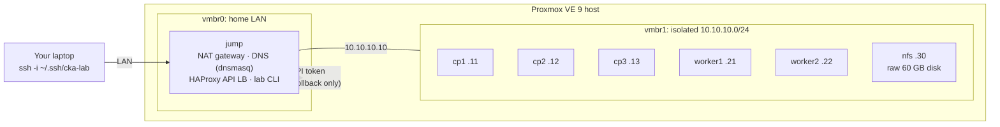

# CKA Lab: a self-hosted, auto-graded Kubernetes v1.35 practice environment

A complete training environment for the **Certified Kubernetes Administrator
(CKA)** exam, built on a Proxmox homelab. It provisions a 7-VM
highly-available cluster environment from bare Ubuntu, then walks through
**31 hands-on labs** and **2 timed mock exams** that cover every competency in
the official [CKA v1.35 curriculum](https://github.com/cncf/curriculum).
Every lab is **graded automatically** against the live cluster.

The labs are deliberately hard. You build the cluster yourself with kubeadm
(load balancer, three stacked control planes, CNI, HA join), upgrade it from
v1.34 to v1.35, restore a three-member etcd from a snapshot, and debug faults
injected into nodes, control planes, workloads and networking.

> **Every lab is verified end to end:** each grader is run against an
> untouched cluster (it must fail) and again after a scripted reference
> solution (it must reach 100%). That process found and fixed real bugs in
> graders, solutions, and once in the host's network driver; see
> [What verification caught](#what-verification-caught).

## Architecture



| VM | Role | vCPU / RAM | Address |
|---|---|---|---|
| jump | workstation, NAT + DNS, HAProxy for `k8s-api.cka.lab:6443`, `lab` CLI | 2 / 2 GB | LAN (DHCP) + 10.10.10.10 |
| cp1–cp3 | stacked control plane (API server, etcd, scheduler, controller-manager) | 2 / 4 GB each | 10.10.10.11–13 |
| worker1–2 | workers (zones a/b) | 3 / 6 GB each | 10.10.10.21–22 |
| nfs | NFS server built from a blank disk in lab 25 | 1 / 1 GB | 10.10.10.30 |

Lab-network services: MetalLB pool `10.10.10.200–220` (L2), Traefik Ingress
on `.201`, Envoy Gateway on `.202`. Cluster domain `cka.local`, pod CIDR
`172.16.0.0/16`, service CIDR `10.112.0.0/16`. The defaults are
deliberately avoided, so muscle memory from tutorials is caught out.

## Curriculum coverage

| Domain (weight) | Labs |
|---|---|
| **Cluster Architecture, Installation & Configuration (25%)** | 01 node prep (containerd 2, kernel, swap) · 02 HAProxy API LB · 03 `kubeadm init` from a 4-document config · 04 Calico via Helm · 05 HA join + CSR vetting · 06 RBAC (CSR users, aggregation, scoped SAs) · 07 v1.34→v1.35 upgrade under a PDB · 08 etcd backup + **3-member HA restore** · 09 Helm + Kustomize · 10 CRDs & operators (cert-manager PKI, own CRD) · 11 CRI/CNI/CSI from the node |
| **Workloads & Scheduling (15%)** | 12 rollouts & rollback · 13 ConfigMaps/Secrets (projected, subPath, modes) · 14 HPA v2 + **in-place pod resize** · 15 probes & native sidecars · 16 DaemonSet/StatefulSet/indexed Job/CronJob · 17 affinity, spread, taints · 18 quota, LimitRange, priority, static pods |
| **Services & Networking (20%)** | 19 Services & EndpointSlices · 20 MetalLB · 21 NetworkPolicy · 22 Ingress (Traefik + cert-manager) · 23 **Gateway API** (Envoy Gateway, canary, ReferenceGrant) · 24 CoreDNS |
| **Storage (10%)** | 25 NFS server from a raw disk + CSI driver · 26 PV/PVC lifecycle (Released PV reuse, local PV, RWOP, expansion) |
| **Troubleshooting (30%)** | 27 NotReady nodes · 28 degraded HA control plane · 29 seven broken workloads · 30 Service/DNS/policy faults · 31 metrics, logs & streams |
| **Mock exams** | 2 × 16 tasks, weighted like the real exam, 120-minute timer, 66% pass mark |

## How it works

### Infrastructure as code (`infra/`)

- **`lab.env`** is the single source of truth: VM IDs, sizes and addresses.
- **`deploy.sh`** renders cloud-init user-data from templates, filling in SSH
  keys and a password hash from a private directory **outside the repo**,
  uploads it as Proxmox snippets, and runs **`proxmox/build.sh`** on the host.
- **`build.sh`** clones an Ubuntu 24.04 cloud-image template, wires NICs to the
  LAN or the isolated bridge, boots the jump host first (it's every node's
  gateway), waits for cloud-init on all VMs via the QEMU guest agent, and takes
  a powered-off `base` snapshot. It's idempotent and touches only its own VM IDs.
- **`install-lab.sh`** installs the framework on the jump host and creates a
  **least-privilege Proxmox API token** (pool `cka-lab`, role with
  `VM.Snapshot`, `VM.Snapshot.Rollback`, `VM.PowerMgmt` and `VM.Audit` only), so
  the lab can snapshot and reset itself without touching other VMs.

Nodes start as a *realistic* bare server: swap on, no container runtime, no
kernel tuning, so lab 01 is real work.

### The `lab` CLI (`lab/`)

```
lab list | show <id> | start <id> [phase] | check <id> | solution <id>
lab exam <n> start | show | status | check
lab snapshots | snapshot <name> | reset <name>
```

- **Graders** are bash scripts on a small assertion library (`check`,
  `check_eq`, `check_match`) that never aborts, so every requirement is
  reported, with expected-vs-found on failure.
- Graders use their **own kubectl** and an admin kubeconfig fetched from a
  control plane, falling back from the load balancer to individual API
  servers, so a student's broken kubectl or HAProxy never decides a grade.
- Helm releases are graded by **decoding Helm's release Secrets** directly,
  so grading never depends on the student's helm binary.
- Many checks are **behavioural**: real TCP connections between pods for
  NetworkPolicy, `--dry-run=server` probes for CRD validation and quotas,
  `auth can-i --as` impersonation for RBAC, 100-request traffic splits for
  Gateway API weights, original object UIDs to prove an etcd restore wasn't
  faked.
- `lab snapshot` shuts the nodes down **in parallel** before snapshotting, so
  all three etcd members are captured at one consistent point.

## What verification caught

Running every lab bare → reference solution → grade on the live cluster
surfaced problems no amount of reading would have:

| Finding | Fix |
|---|---|
| Host dropped off the network mid-build: Intel I219 (`e1000e`) "Detected Hardware Unit Hang" ×2159 under heavy image-pull traffic | Disabled TSO/GSO/GRO on the uplink persistently (`post-up ethtool -K`) |
| During the HA upgrade a worker went **NotReady**: kubeadm API servers only use their *local* etcd, and HAProxy kept the kubelet's long-lived connection pinned to a backend marked DOWN | Added `on-marked-down shutdown-sessions` to the LB; now a lab 02 requirement |
| Calico ≥ 3.31 ships its CRDs in a separate chart; following older docs fails | Lab 04 makes you follow the version-specific procedure |
| Envoy Gateway's proxies never became ready: the controller's address is built with `cluster.local`, but this cluster's domain is `cka.local` | `kubernetesClusterDomain=cka.local`; lab 23 now hints at the trap |
| Traefik treats `pathType: Prefix` as a string prefix (`/api` matched `/apiv2`), orders routers by rule length, and its default router didn't serve HTTPS | `strictPrefixMatching`, plus a separate low-priority catch-all Ingress |
| OOM kills reported as `Reason: Error` (exit 137), not `OOMKilled`: the kernel charged the kill to the pod-level cgroup, which containerd 2.4 doesn't attribute to the container | Tasks grade exit code 137, and the solutions teach confirming with the node's `dmesg` |
| Python's `bytearray(N)` never touched its pages, so "out of memory" workloads didn't reliably hit their limit | Allocate with `b"x" * N` |
| Helm's release record for Traefik is 2 MB, too large to pass as an argument, so a grader crashed | Stream release data through stdin |
| kubeadm packages no longer pull in `cri-tools`, so `crictl` was missing | Solution installs it explicitly |
| The CSR-vetting script used `openssl req -ext`, which doesn't exist, so SAN checks silently passed everything | Parse `-text` output; the forged CSR in lab 05 now fails on SANs as well |
| A grader split `containerRuntimeEndpoint: unix:///...` on `:` and compared `unix` to `unix` | `sed` instead of `awk -F:` |
| `tr … </dev/urandom \| head` killed a setup script with SIGPIPE under `pipefail` | `openssl rand` |
| In-place resize with `--type=merge` replaced the whole container list | Strategic merge patch (documented in the solution) |
| First-draft graders passed 100 of 145 checks on **bare** nodes (double-quoting through ssh + `sudo bash -c`) | Fixed quoting; every grader now scores ~0% bare |

## Getting started

Requirements: a Proxmox VE 8/9 host with ~30 GB free RAM and ~150 GB of thin
storage, and a free bridge name for the isolated network.

```bash
# 1. Add the isolated bridge (vmbr1, no ports) on the Proxmox host, then create
#    an Ubuntu 24.04 cloud-image template (ID 9000); see infra/proxmox/build.sh.
# 2. Secrets live outside the repo:
mkdir -p ~/.local/share/cka-lab && cd ~/.local/share/cka-lab
ssh-keygen -t ed25519 -N '' -f lab_internal_ed25519
openssl rand -base64 18 > student-password
ssh-keygen -t ed25519 -N '' -f ~/.ssh/cka-lab
# 3. Build and install:
PVE=root@<proxmox> infra/deploy.sh
PVE=root@<proxmox> infra/install-lab.sh
ssh -i ~/.ssh/cka-lab student@<jump-ip>
lab list
```

## Repository layout

```
infra/
  lab.env                 topology: VM IDs, sizes, addresses
  cloud-init/             jump + node user-data templates
  deploy.sh               render, upload, build
  proxmox/build.sh        runs on the Proxmox host
  install-lab.sh          framework + scoped API token on the jump host
lab/
  bin/lab                 the CLI
  lib/common.sh           node access, grader kubectl, helm release decoding
  lib/grade.sh            assertion helpers
  labs/NN-name/           meta · task.md · setup.sh · check.sh
  exams/N/                README + tasks/NN-name/{meta,task.md,setup.sh,check.sh}
```

Reference solutions (and the scripts that verify every lab) are kept in a
separate private repository, so the labs stay useful as practice.

## Versions

Kubernetes v1.34.12 → v1.35.9 · containerd 2.x · Calico v3.32.2 · Helm 3.22 ·
MetalLB 0.16.1 · Traefik chart 41.7.1 · Envoy Gateway v1.9.2 ·
cert-manager v1.21.2 · csi-driver-nfs v4.13.5 · metrics-server chart 3.14.0 ·
etcd 3.6 · Ubuntu 24.04.
