<p align="center"></p>

# HelmYard: a self-hosted, auto-graded Kubernetes practice environment

*Kubernetes Playgrounds* for the CKA today and the whole Kubestronaut path next.

A complete training environment for the **Certified Kubernetes Administrator
(CKA)** exam, built on a Proxmox homelab. It provisions a 7-VM
highly-available cluster environment from bare Ubuntu, then walks through
**31 hands-on labs** and **2 timed mock exams** that cover every competency in
the official [CKA v1.35 curriculum](https://github.com/cncf/curriculum).
Every lab is **graded automatically** against the live cluster.

The labs are deliberately hard. You build the cluster yourself with kubeadm
(load balancer, three stacked control planes, CNI, HA join), upgrade it from
v1.34 to v1.35, restore a three-member etcd from a snapshot, and debug faults
injected into nodes, control planes, workloads and networking.

Work in the terminal over SSH, or in **HelmYard**, the browser
console on the jump host: the task on the left, a real shell on the right, a
**Check** button that grades on demand, and a timed exam mode. No hints: the
labs are challenges, like the exam. See
[Kubernetes Playgrounds](#kubernetes-playgrounds-web-console-labweb).

<p align="center">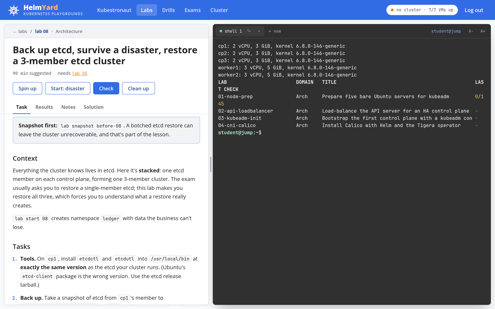</p>

> **Every lab is verified end to end:** each grader is run against an
> untouched cluster (it must fail) and again after a scripted reference
> solution (it must reach 100%). That process found and fixed real bugs in
> graders, solutions, and once in the host's network driver; see
> [What verification caught](#what-verification-caught).

## Kubestronaut

The platform is growing from CKA practice into preparation for all five
certifications a **Kubestronaut** holds. The web console opens on a **roadmap**
that takes them in this order: **CKA → CKS → CKAD → KCNA → KCSA**. Build and
repair a cluster first, then secure it (CKS needs a passed CKA), then ship
applications on it, and finish with the two multiple-choice exams. Each step
shows its official domains and weights (`lab/tracks.json`) and your progress.
KCNA and KCSA already run on a quiz engine with domain practice and timed mock
exams; CKAD and CKS are mapped to their curricula, and their labs are next. See
[docs/ROADMAP.md](docs/ROADMAP.md).

## Architecture

<p align="center">
  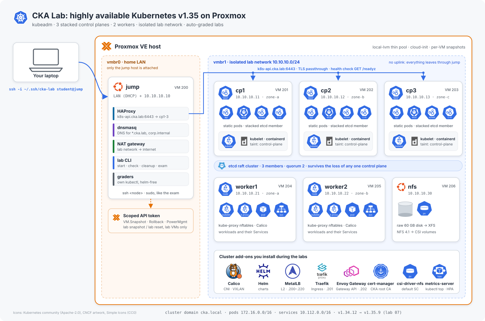
</p>

<sub>Generated by <code>docs/diagram/build.py</code> from the official Kubernetes community icons and project logos (<a href="docs/diagram/icons/SOURCES.md">sources</a>).</sub>

| VM | Role | vCPU / RAM | Address |
|---|---|---|---|
| jump | workstation, NAT + DNS, HAProxy for `k8s-api.cka.lab:6443`, `lab` CLI | 2 / 2 GB | LAN (DHCP) + 10.10.10.10 |
| cp1–cp3 | stacked control plane (API server, etcd, scheduler, controller-manager) | 2 / 4 GB each | 10.10.10.11–13 |
| worker1–2 | workers (zones a/b) | 3 / 6 GB each | 10.10.10.21–22 |
| nfs | NFS server built from a blank disk in lab 25 | 1 / 1 GB | 10.10.10.30 |

Lab-network services: MetalLB pool `10.10.10.200–220` (L2), Traefik Ingress
on `.201`, Envoy Gateway on `.202`. Cluster domain `cka.local`, pod CIDR
`172.16.0.0/16`, service CIDR `10.112.0.0/16`. The defaults are
deliberately avoided, so muscle memory from tutorials is caught out.

## Curriculum coverage

| Domain (weight) | Labs |
|---|---|
| **Cluster Architecture, Installation & Configuration (25%)** | 01 node prep (containerd 2, kernel, swap) · 02 HAProxy API LB · 03 `kubeadm init` from a 4-document config · 04 Calico via Helm · 05 HA join + CSR vetting · 06 RBAC (CSR users, aggregation, scoped SAs) · 07 v1.34→v1.35 upgrade under a PDB · 08 etcd backup + **3-member HA restore** · 09 Helm + Kustomize · 10 CRDs & operators (cert-manager PKI, own CRD) · 11 CRI/CNI/CSI from the node |
| **Workloads & Scheduling (15%)** | 12 rollouts & rollback · 13 ConfigMaps/Secrets (projected, subPath, modes) · 14 HPA v2 + **in-place pod resize** · 15 probes & native sidecars · 16 DaemonSet/StatefulSet/indexed Job/CronJob · 17 affinity, spread, taints · 18 quota, LimitRange, priority, static pods |
| **Services & Networking (20%)** | 19 Services & EndpointSlices · 20 MetalLB · 21 NetworkPolicy · 22 Ingress (Traefik + cert-manager) · 23 **Gateway API** (Envoy Gateway, canary, ReferenceGrant) · 24 CoreDNS |
| **Storage (10%)** | 25 NFS server from a raw disk + CSI driver · 26 PV/PVC lifecycle (Released PV reuse, local PV, RWOP, expansion) |
| **Troubleshooting (30%)** | 27 NotReady nodes · 28 degraded HA control plane · 29 seven broken workloads · 30 Service/DNS/policy faults · 31 metrics, logs & streams |
| **Mock exams** | 2 × 16 tasks, weighted like the real exam, 120-minute timer, 66% pass mark |

## How it works

### Infrastructure as code (`infra/`)

- **`lab.env`** is the single source of truth: VM IDs, sizes and addresses.
- **`deploy.sh`** renders cloud-init user-data from templates, filling in SSH
  keys and a password hash from a private directory **outside the repo**,
  uploads it as Proxmox snippets, and runs **`proxmox/build.sh`** on the host.
- **`build.sh`** clones an Ubuntu 24.04 cloud-image template, wires NICs to the
  LAN or the isolated bridge, boots the jump host first (it's every node's
  gateway), waits for cloud-init on all VMs via the QEMU guest agent, and takes
  a powered-off `base` snapshot. It's idempotent and touches only its own VM IDs.
- **`install-lab.sh`** installs the framework on the jump host and creates a
  **least-privilege Proxmox API token** (pool `cka-lab`, role with
  `VM.Snapshot`, `VM.Snapshot.Rollback`, `VM.PowerMgmt` and `VM.Audit` only), so
  the lab can snapshot and reset itself without touching other VMs.

Nodes start as a *realistic* bare server: swap on, no container runtime, no
kernel tuning, so lab 01 is real work.

### The `lab` CLI (`lab/`)

```
lab list | show <id> | start <id> [phase] [--same] | up <id> | check <id> | solution <id>
lab drill [list] | <id> | random [domain] | check <id> | cleanup <id>
lab exam <n> start | prep | up | show | status | check
lab snapshots [delete <name>] | snapshot <name> | reset <name>
lab cleanup <id> | exam <n> cleanup
```

- **Harder than the exam, on purpose.** Tasks have no hints (no "Notes" or
  tips sections; only the requirement and links to the official docs),
  several break things that have to be found first, and drill budgets are
  tighter than the real exam allows.
- **Fresh values every attempt.** A lab or drill can declare randomised values
  in a `params` file (`int`, `pick`, `word`, `hex`, `calc` generators).
  `lab start` draws them into `~/.cka-lab/params/<lab>.env`; the task text
  shows them through `{{PLACEHOLDERS}}`, and setup, grader, cleanup and the
  reference solution all read the same file. A retake asks for different
  ports, names and numbers, so it tests skill, not memory. `--same` keeps the
  current values. Lab 19 and every drill use this; more labs follow.
- **Speed drills** (`lab/drills/`) are single tasks against a clock, from 1:30
  to 3:00, with fresh values each start. The clock runs from setup until every
  check passes, and every run is recorded with its time.
- **Mock exams use kubeconfig contexts** like the real exam: every task has its
  own (`e1-t3` for task 3, default namespace `e1-t3`), and the exam view shows
  the `use-context` line to paste first.

- **Graders** are bash scripts on a small assertion library (`check`,
  `check_eq`, `check_match`) that never aborts, so every requirement is
  reported, with expected-vs-found on failure.
- Graders use their **own kubectl** and an admin kubeconfig fetched from a
  control plane, falling back from the load balancer to individual API
  servers, so a student's broken kubectl or HAProxy never decides a grade.
- Helm releases are graded by **decoding Helm's release Secrets** directly,
  so grading never depends on the student's helm binary.
- Many checks are **behavioural**: real TCP connections between pods for
  NetworkPolicy, `--dry-run=server` probes for CRD validation and quotas,
  `auth can-i --as` impersonation for RBAC, 100-request traffic splits for
  Gateway API weights, original object UIDs to prove an etcd restore wasn't
  faked.
- `lab snapshot` shuts the nodes down **in parallel** before snapshotting, so
  all three etcd members are captured at one consistent point.
- **Resets keep your progress.** A snapshot covers the six node VMs plus the
  jump host's *lab state*: what the labs install and write there (kubectl and
  its apt repository, Helm, HAProxy, the kubeconfig, files in the home
  directory), saved as a file. `lab reset` rolls the nodes back and puts that
  state back exactly, removing packages and files added since. The jump VM itself
  keeps running, so grades, exam history and notes survive, open shells and
  the web console stay connected, and editor state (`~/.vscode-server`) is
  untouched. Snapshots taken before this existed still roll back the jump VM.

### Kubernetes Playgrounds (web console, `lab/web/`)

Kubernetes Playgrounds is a browser front end for the same framework, served by the jump host at
`https://<jump-ip>/`. It runs the same `lab` commands as the CLI, so the two
can be mixed freely.

| | |
|---|---|
| **Roadmap** (home) | the five certifications in order, with where you are; what you're working on (and how far its setup is), the cluster's power state, and the idle-shutdown countdown |
| **Working on** | starting a lab, drill, mock exam or playground records it on the server: **Preparing** while its setup runs (with the line it's on), then **In progress**, or **Setup failed**/**Interrupted**. A chip in the top bar, the catalogue cards and the workspace all show it, in every tab and after a reload, so leaving the page never loses track. Job output is kept on disk, and every multi-step start (prerequisites, snapshot, setup) is one server-side job |
| **Playground** | a working cluster to try commands on, with no tasks and no grading: **Core** (HA control plane and two workers on v1.35) or **Full stack** (plus metrics-server, cert-manager, MetalLB, Traefik, Envoy Gateway and NFS storage), beside a terminal. The first build uses the reference solutions and is saved as a **live snapshot** (the VMs' memory included, taken with every node paused so the cluster is frozen at one instant, after dropping the guests' file cache so only memory in use is saved); every spin-up after that resumes the VMs already running: **44–47 s** measured for the full stack |
| **CKA dashboard** | a live `lab status` terminal card for the 7 VMs; exam readiness as a ring and a bar per domain (weighted like the exam); an "up next" card; labs passed (one square per lab, coloured by domain), checks passing, best mock exam, a 14-day activity chart; and the labs as a searchable, filterable card catalogue |
| **Lab workspace** | the task (with its documentation links) beside a terminal; **Start** (or **Spin up**, when earlier labs it builds on aren't done), **Check**, **Clean up** stream their output live; a **Results** tab lists every check, grouped, with expected-vs-found; per-lab notes saved on the jump host; solutions behind a "try first" prompt |
| **Terminals** | real login shells (xterm.js over a WebSocket to a PTY). Sessions live on the server, so a reload or a closed tab reattaches to the same shell; several tabs, renamed by double-clicking (names are kept on the server); JetBrains Mono Nerd Font, so prompt and `ls` icons render; code blocks in the task have a **paste** button that types into the shell without pressing Enter |
| **Speed drills** | a catalogue with best times, a drill workspace with the clock against the budget, Start (new values), Check, Clean up, and a bar per past run |
| **Mock exams** | briefing, optional snapshot before setup, 120-minute countdown, the task's kubeconfig context to paste, question navigator with weights and flags, a notepad, auto-grade when time runs out, weighted results per task with **time spent against each task's share of the clock**, and a review mode showing which checks failed |
| **Cluster** | **power**: start or shut down the cluster VMs, shut everything down, set the idle shutdown (15 min to 4 h, or never) or keep it on for 3 hours; power state of the 7 VMs (Proxmox API) and node status (Kubernetes), snapshots: take, delete, reset (typed confirmation; the page stays connected, except for older snapshots that roll back the jump VM, where it waits and reconnects) |

<table><tr>
<td>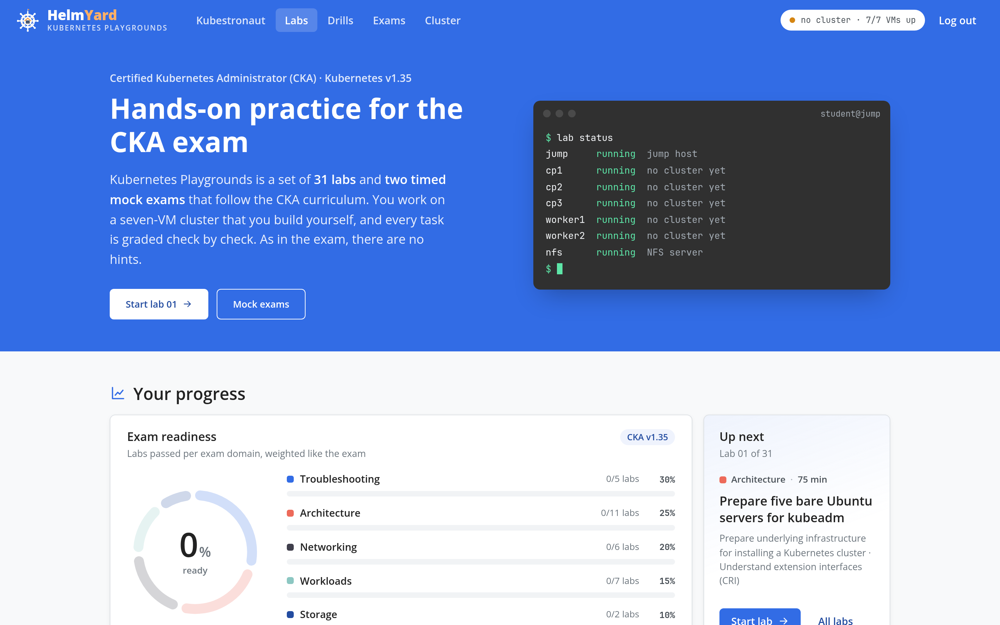</td>
<td>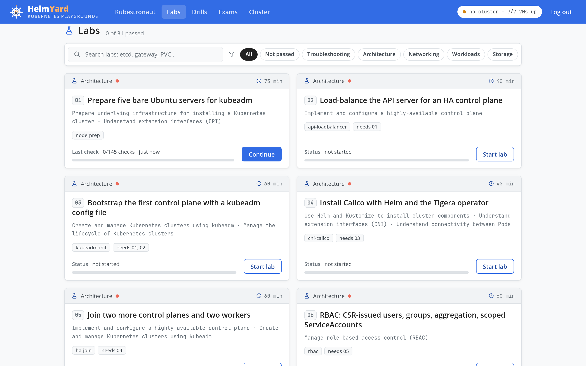</td>
</tr><tr>
<td>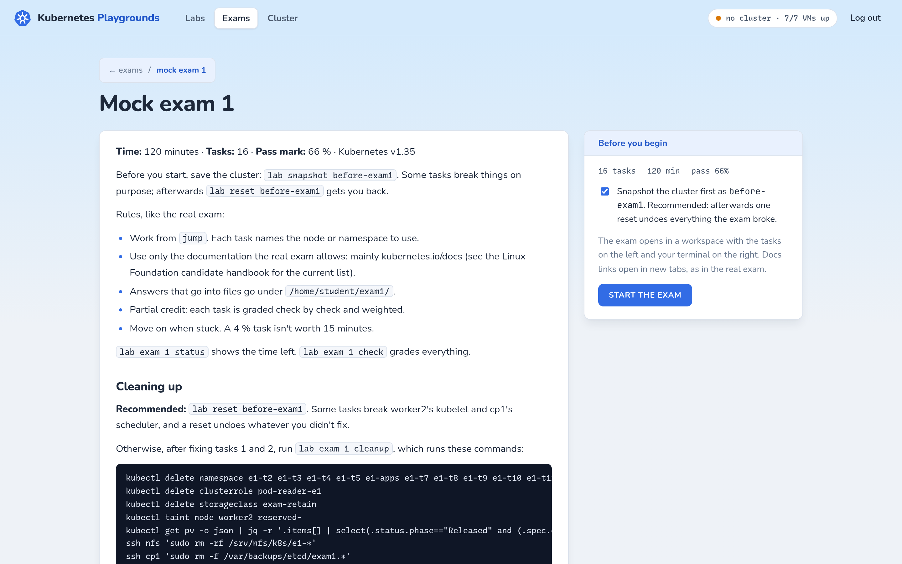</td>
<td></td>
</tr><tr>
<td>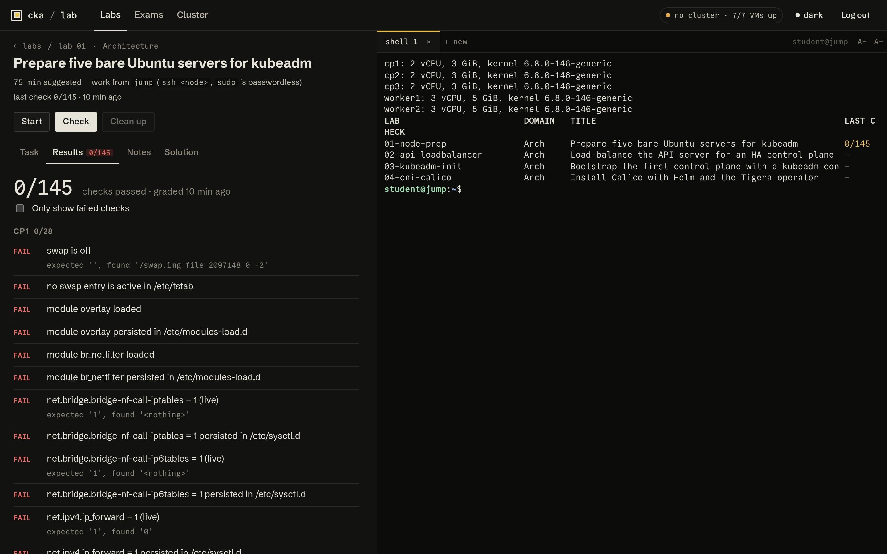</td>
<td>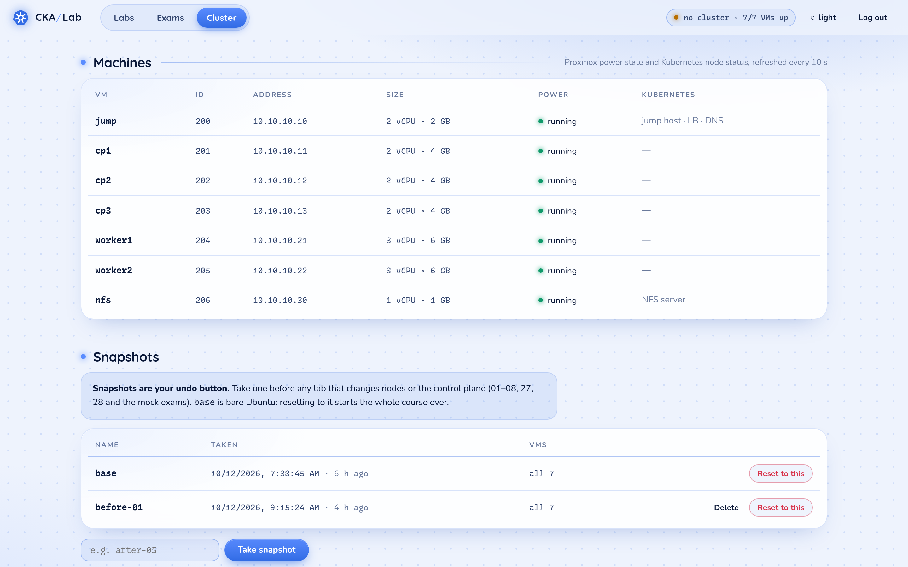</td>
</tr><tr>
<td>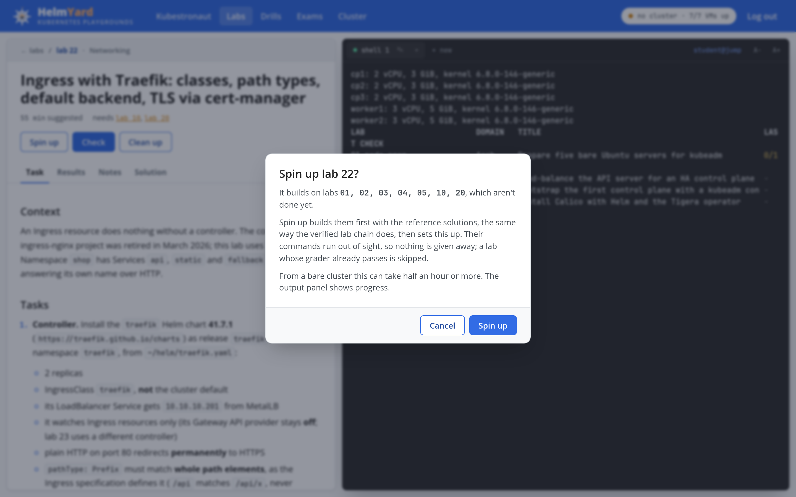</td>
<td>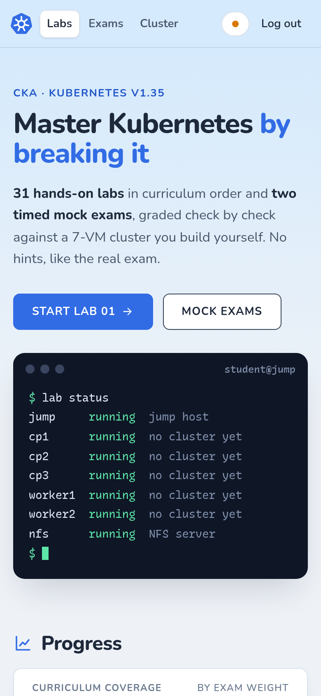</td>
</tr><tr>
<td>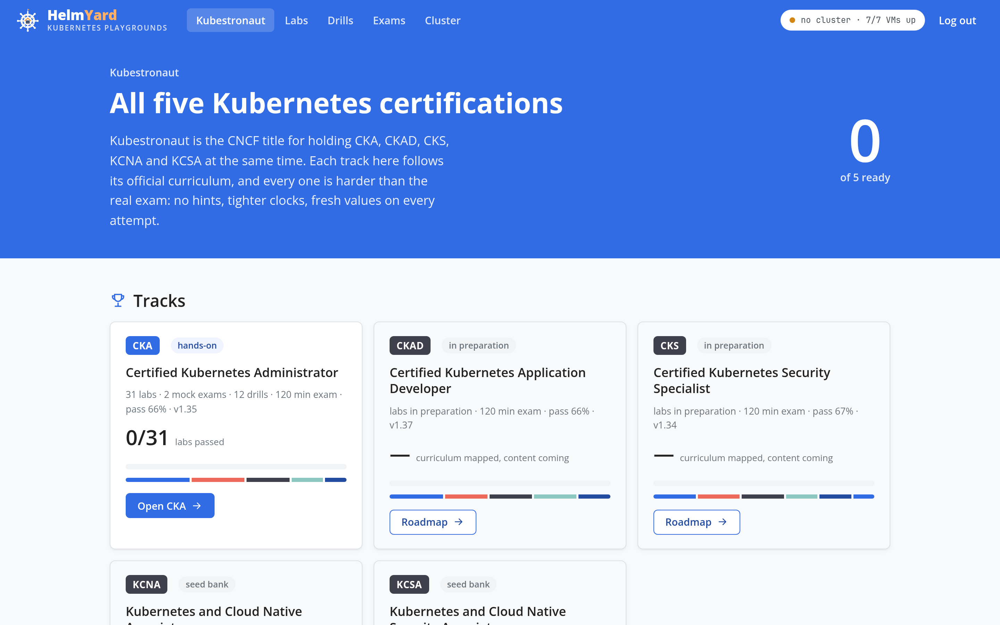</td>
<td>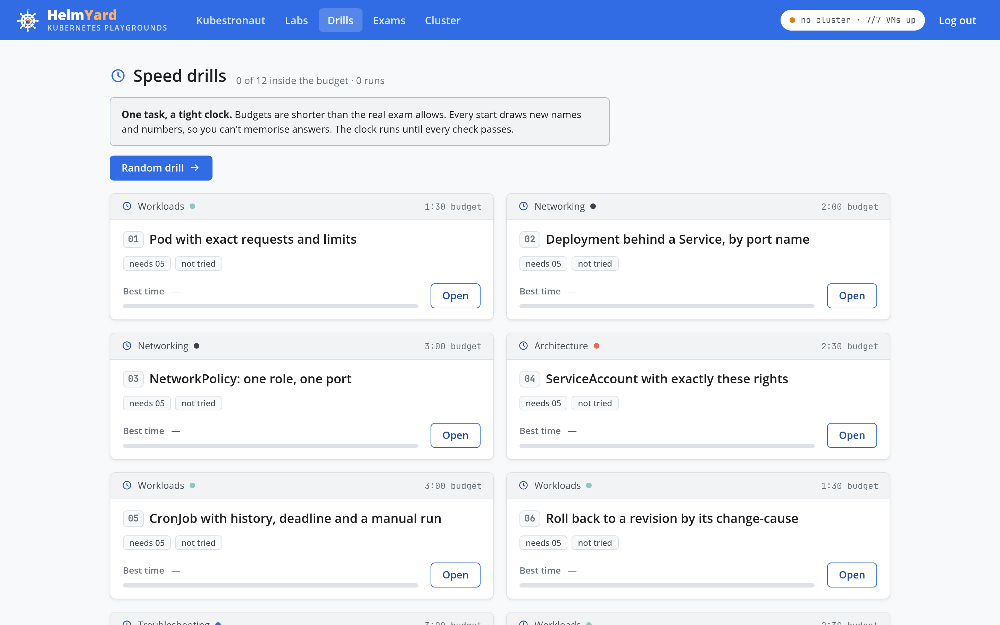</td>
</tr></table>


How it's built:

- **Server:** one Python file (`lab/web/server.py`) on aiohttp from Ubuntu's
  own packages, so nothing comes from pip. It runs as `student` under systemd
  and binds port 443 with `CAP_NET_BIND_SERVICE` instead of root.
- **Jobs:** each button maps to a fixed `lab` command line (an allow-list, never
  a shell string). One job runs at a time and its output streams over
  server-sent events. The grader now also writes every check (section, result,
  detail) to its JSON result, which the Results tab renders.
- **TLS:** `install-lab.sh` creates a small local CA on your machine (next to
  the other secrets in `~/.local/share/cka-lab`, never in the repo) and signs
  the jump host's certificate with it; the jump host's key never leaves it.
  The CA is **name-constrained** to private addresses and `*.cka.lab`, so
  trusting it with `tools/trust-console-ca.sh` (macOS, Arch/Fedora,
  Debian/Ubuntu, plus the Chrome/Firefox NSS stores) can't let it vouch for
  real websites. After that the browser opens the console without a warning.
- **Security:** the login is the student password, stored on the jump host only
  as a salted PBKDF2 hash. The session cookie is HttpOnly, Secure and
  SameSite=Strict. Changes need a custom header and a same-origin `Origin`,
  WebSocket upgrades check `Origin` too, and the CSP allows only same-origin
  scripts. Failed logins are rate limited. TLS uses a self-signed certificate
  for the jump host's address, so the browser asks you to accept it once.
- **Front end:** plain JavaScript with no build step. xterm.js, marked and
  DOMPurify are vendored at pinned versions, so the console works without
  internet access.
- **Brand and design:** HelmYard, *Kubernetes Playgrounds*. The official kit is in
  [`docs/brand/kit/`](docs/brand/kit/01_Brand_Guidelines/BRAND_GUIDELINES.md)
  (generated by its `setup_brandkit.py`): palette (Night Navy `#0E1E38`, Deep
  Surface `#162B4D`, Kube Blue `#326CE5`, Playground Orange `#FF8E3C`, Lively
  Teal `#1CD1A1`, Slate `#8A99AD`), wordmark lockups, favicon, and CSS, Tailwind
  and W3C design tokens. `docs/brand/build.py` draws the helm-and-server mark as
  SVG (colour and reversed) and the README banner. The console uses the kit's
  light variant: a Cloud canvas (`#F8FAFC`) with a faint dot grid, white cards
  and Night Navy text, under a Night Navy top bar; terminals stay dark. Kube
  Blue for buttons, Playground Orange for the main calls to action and anything
  being prepared, teal for healthy and passed, each darkened when it's small
  text so it stays readable on white. The roadmap hero shows the kit's mascot.
  The page declares `color-scheme: only light` and `darkreader-lock`, so
  browser dark modes and the Dark Reader extension leave the design alone.
  The top bar is light too, with the pages as pills. Navigation is **Roadmap · Playground · Cluster**; a certification's labs,
  speed drills and mock exams are tabs inside its track (`#/cka`,
  `#/cka/drills`, `#/cka/exams`). Interface text is Inter;
  anything you could type, the terminal included, is JetBrains Mono Nerd Font
  (the Mono variant, so icons keep to one cell). Both fonts are OFL and served
  locally; their licenses sit next to the files in `lab/web/static/fonts/`.
- **Screenshots:** made by `tools/web-screenshots.mjs`, which drives headless
  Chrome over the DevTools protocol with no npm packages.

Resets leave the jump host's software alone, so the console survives them.
Only an old snapshot that still rolls back the jump VM can bring back a jump
host without it; re-run `infra/install-lab.sh` afterwards. Restarting the service ends open browser shells.

Keep it on your LAN. It is a root-capable shell on your lab, so for remote
access use a VPN such as Tailscale rather than forwarding the port.

## What verification caught

Running every lab bare → reference solution → grade on the live cluster
surfaced problems no amount of reading would have:

| Finding | Fix |
|---|---|
| Host dropped off the network mid-build: Intel I219 (`e1000e`) "Detected Hardware Unit Hang" ×2159 under heavy image-pull traffic | Disabled TSO/GSO/GRO on the uplink persistently (`post-up ethtool -K`) |
| During the HA upgrade a worker went **NotReady**: kubeadm API servers only use their *local* etcd, and HAProxy kept the kubelet's long-lived connection pinned to a backend marked DOWN | Added `on-marked-down shutdown-sessions` to the LB; now a lab 02 requirement |
| Calico ≥ 3.31 ships its CRDs in a separate chart; following older docs fails | Lab 04 makes you follow the version-specific procedure |
| Envoy Gateway's proxies never became ready: the controller's address is built with `cluster.local`, but this cluster's domain is `cka.local` | `kubernetesClusterDomain=cka.local`; lab 23 now hints at the trap |
| Traefik treats `pathType: Prefix` as a string prefix (`/api` matched `/apiv2`), orders routers by rule length, and its default router didn't serve HTTPS | `strictPrefixMatching`, plus a separate low-priority catch-all Ingress |
| OOM kills reported as `Reason: Error` (exit 137), not `OOMKilled`: the kernel charged the kill to the pod-level cgroup, which containerd 2.4 doesn't attribute to the container | Tasks grade exit code 137, and the solutions teach confirming with the node's `dmesg` |
| Python's `bytearray(N)` never touched its pages, so "out of memory" workloads didn't reliably hit their limit | Allocate with `b"x" * N` |
| Helm's release record for Traefik is 2 MB, too large to pass as an argument, so a grader crashed | Stream release data through stdin |
| kubeadm packages no longer pull in `cri-tools`, so `crictl` was missing | Solution installs it explicitly |
| The CSR-vetting script used `openssl req -ext`, which doesn't exist, so SAN checks silently passed everything | Parse `-text` output; the forged CSR in lab 05 now fails on SANs as well |
| A grader split `containerRuntimeEndpoint: unix:///...` on `:` and compared `unix` to `unix` | `sed` instead of `awk -F:` |
| `tr … </dev/urandom \| head` killed a setup script with SIGPIPE under `pipefail` | `openssl rand` |
| In-place resize with `--type=merge` replaced the whole container list | Strategic merge patch (documented in the solution) |
| First-draft graders passed 100 of 145 checks on **bare** nodes (double-quoting through ssh + `sudo bash -c`) | Fixed quoting; every grader now scores ~0% bare |

## Getting started

Requirements: a Proxmox VE 8/9 host with ~30 GB free RAM and ~150 GB of thin
storage, and a free bridge name for the isolated network.

```bash
# 1. Add the isolated bridge (vmbr1, no ports) on the Proxmox host, then create
#    an Ubuntu 24.04 cloud-image template (ID 9000); see infra/proxmox/build.sh.
# 2. Secrets live outside the repo:
mkdir -p ~/.local/share/cka-lab && cd ~/.local/share/cka-lab
ssh-keygen -t ed25519 -N '' -f lab_internal_ed25519
openssl rand -base64 18 > student-password
ssh-keygen -t ed25519 -N '' -f ~/.ssh/cka-lab
# 3. Build and install:
PVE=root@<proxmox> infra/deploy.sh
PVE=root@<proxmox> infra/install-lab.sh
ssh -i ~/.ssh/cka-lab student@<jump-ip>
lab list
# or open https://<jump-ip>/ and log in with the student password
```

## On demand: nothing has to run all the time

HelmYard switches itself off and comes back when you want it:

- **The cluster VMs** start when a command needs them. Every `lab` command that
  works on the cluster (start, up, check, cleanup, drills, exams, playground,
  snapshot) first starts any node VM that is off and waits until the nodes are
  Ready. `lab power on|off|status` does it by hand.
- **Idle shutdown:** after 30 minutes without use (no clicks or keys in the
  console, no typing in a terminal, no job running, no mock exam on the clock)
  the console shuts the cluster VMs down, then the jump host. It warns five
  minutes ahead with a **Stay on** button. The Cluster page sets the delay or
  turns it off.
- **The gate** (`infra/gate/`) is the one thing that stays on: an Alpine LXC
  on Proxmox with 128 MB of RAM, serving a HelmYard start page with the Python
  standard library alone. Sign in with the student password and press **Start**:
  it boots the jump host and takes you to the console when it answers. It can
  also start the cluster with it, or shut everything down. It has its own
  Proxmox API token that, like the jump host's, can only see and power the lab
  VMs, and a certificate from the console CA.

```bash
PVE=root@<proxmox> infra/gate/install-gate.sh     # creates CT 207 "helmyard-gate" and links the console to it
```

When the console is off, an open browser tab says so and links to the gate.

## Spinning a lab up on demand

Every lab can be started on its own, even on a bare cluster. `lab up <id>`
works out which earlier labs it builds on (each lab's `NEEDS`, followed through
their own needs), skips any that are done, and builds the rest with the
reference solutions before running the lab's setup:

```bash
lab up 22               # needs 10 and 20, which need 05 ... 01: builds what's missing, then starts 22
lab exam 1 up           # the same for a mock exam (it assumes 07, 09, 23 and 25)
lab exam 1 begin --snapshot   # prerequisites, a before-exam1 snapshot, then the exam: what the console's Start runs
lab playground full     # a working cluster with the usual add-ons: built once, then about a minute (live snapshot pg-full)
```

A prerequisite counts as done when it passed `lab check`, was built by an
earlier `lab up`, or its grader passes now (checked quietly, nothing
recorded). Labs are probed from the highest down, and a lab that passes vouches
for everything it needed, so an early lab is never re-run on a cluster that has
moved past it. Each build does what the verified 01 → 31 chain does: setup,
reference solution, grade at 100 %, cleanup. The solution output goes to
`~/.cka-lab/up/<lab>.log`, not the screen, so nothing about those labs is
spoiled. It needs the private solutions installed (`install-lab.sh --solutions
<dir>`); in the web console **Start** turns into **Spin up** and asks first.
`lab list` shows those labs as "built by lab up".

Some labs build part of the cluster that others stand on: 01–05, the upgrade
(07), Helm, CRDs, MetalLB, ingress, Gateway API and NFS. Such a lab can't be
done on a cluster that already has it (after the playground, or after you did it
or a lab built on it). `lab up` then rolls the nodes back to `base` first and
builds only what the lab needs. Lab 07 after the playground, for example, comes
back on the cached v1.34 core in about two minutes. The console says so before it
starts.

The first spin-up from a bare cluster builds the core (labs 01–05) and caches it
as the snapshot `up-core`, which takes about 20 minutes. After that, a spin-up
from bare rolls the nodes back to `up-core` in a few minutes and builds only
what's left. Restoring it only *adds* to the jump host, so none of your files
are removed. The cache is ignored, and rebuilt, when labs 01–05 or their
solutions change. `lab snapshots delete up-core` frees its space.

## Resetting and retrying

Every lab's `task.md` ends with two sections: **Cleaning up** (what to remove
after you pass, and what to keep because later labs need it) and **Restarting
this lab** (the exact way to get back to its starting state). The mock exam
READMEs have the same. In general there are two levels of reset.

**1. Re-run a lab's setup** (fast, one namespace). For labs 12–26 and 29–31,
`lab start <id>` deletes the lab's namespace and recreates its starting
objects, so you can retry the tasks. It does **not** undo cluster-wide things
you installed during the lab (Helm releases, StorageClasses, CoreDNS edits,
node labels). Those stay, which is usually what you want when retrying.

**2. Snapshots** (whole cluster, about 2–4 minutes). Labs 01–11, 27 and 28
change the nodes or the control plane itself, so the only clean retry is a
snapshot:

```bash
lab snapshot before-08     # take one BEFORE starting a risky lab
# ... attempt the lab ...
lab reset before-08        # roll the cluster back; grades and notes are kept, nobody is disconnected
lab snapshots              # list them
lab snapshots delete before-08   # free the space once you're past it
lab reset base             # start completely over: bare nodes, framework still installed
```

Suggested checkpoints: `cluster-ready` after lab 05, `upgraded` after lab 07,
and one before each mock exam. `lab snapshot` briefly shuts the nodes down so
all three etcd members are captured at the same moment.

## Repository layout

```
infra/
  lab.env                 topology: VM IDs, sizes, addresses
  cloud-init/             jump + node user-data templates
  deploy.sh               render, upload, build
  proxmox/build.sh        runs on the Proxmox host
  install-lab.sh          framework, web console, scoped API token on the jump host
  gate/                   the always-on start page (gate.py, index.html) and install-gate.sh
lab/
  bin/lab                 the CLI
  web/server.py           the web console (aiohttp): API, jobs, terminals
  web/static/             front end: app.js, app.css, vendored xterm.js/marked/DOMPurify, fonts
  lib/common.sh           node access, grader kubectl, helm release decoding
  lib/grade.sh            assertion helpers
  labs/NN-name/           meta · task.md · setup.sh · check.sh · cleanup.sh · [params]
  drills/NN-name/         meta · params · task.md · setup.sh · check.sh · cleanup.sh
  exams/N/                README + cleanup.sh + tasks/NN-name/{meta,task.md,setup.sh,check.sh}
docs/
  architecture.svg        the diagram above (generated)
  diagram/                build.py + icons (official Kubernetes icons, project logos)
  brand/                  HelmYard logo kit: build.py draws the mark (colour, reversed) and the banner
  ROADMAP.md              the Kubestronaut plan: CKAD, CKS, KCNA, KCSA
tools/
  references.py           per-lab documentation links → "References" in each task.md
  add-references.py       writes those sections
  check-links.sh          verifies every link still resolves
  gen-cleanup.py          generates cleanup.sh from each task's "Cleaning up" section
  web-screenshots.mjs     README screenshots of the web console (headless Chrome)
  validate.py             offline consistency checks (metadata, prerequisites, placeholders, README images)
  versions.json           every pinned component version, in one place
  check-versions.py       compares those pins and the CNCF curricula with upstream
  trust-console-ca.sh     trusts the console CA on this machine (you run it)
.github/workflows/ci.yml  syntax, ShellCheck, validate, generated files; weekly links + version report
docs/web/                 those screenshots
```

Every lab's `task.md` ends with **References** (official docs, kubernetes.io
first), **Cleaning up** and **Restarting this lab**.

Reference solutions (and the scripts that verify every lab) are kept in a
separate private repository, so the labs stay useful as practice.

## License

[MIT](LICENSE)

## Versions

Pinned in `tools/versions.json`; `tools/check-versions.py` (weekly in CI)
reports anything upstream has moved past, and new CNCF curricula.

Kubernetes v1.34.12 → v1.35.9 · containerd 2.x · Calico v3.32.2 · Helm 3.22 ·
MetalLB 0.16.1 · Traefik chart 41.7.1 · Envoy Gateway v1.9.2 ·
cert-manager v1.21.2 · csi-driver-nfs v4.13.5 · metrics-server chart 3.14.0 ·
etcd 3.6 · Ubuntu 24.04.
